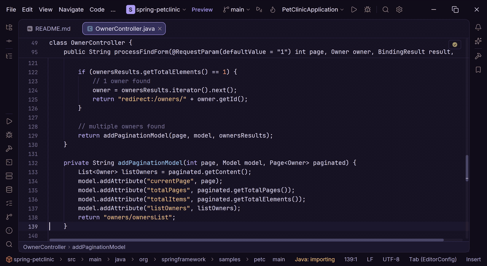
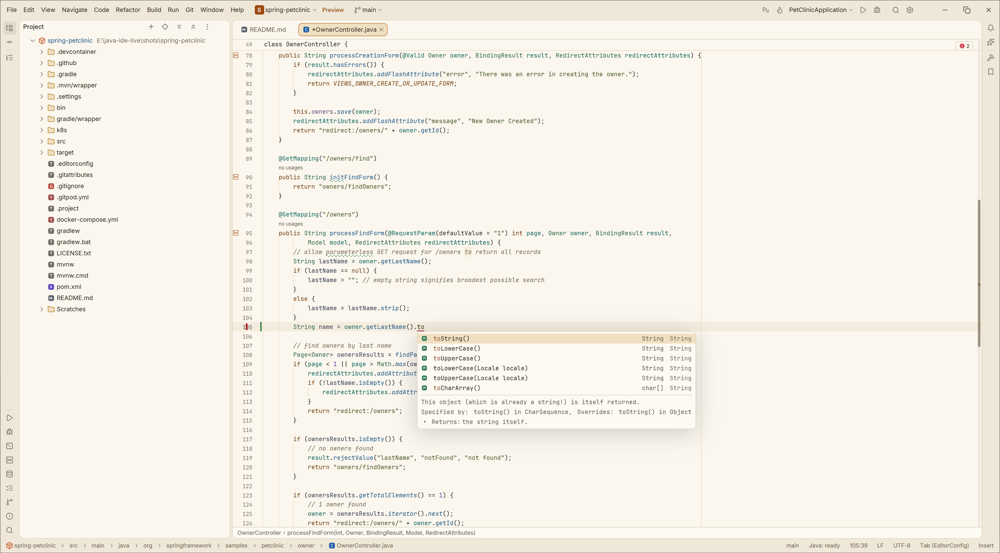
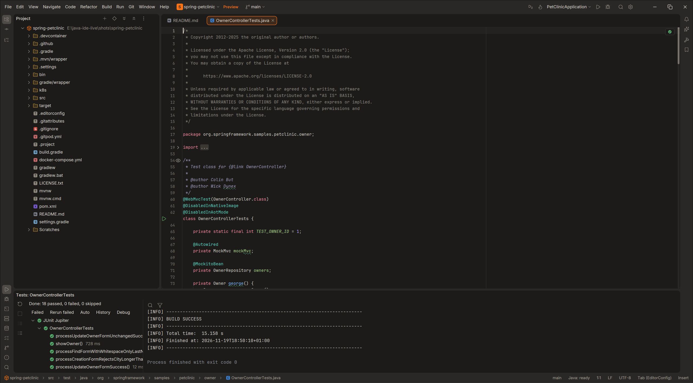
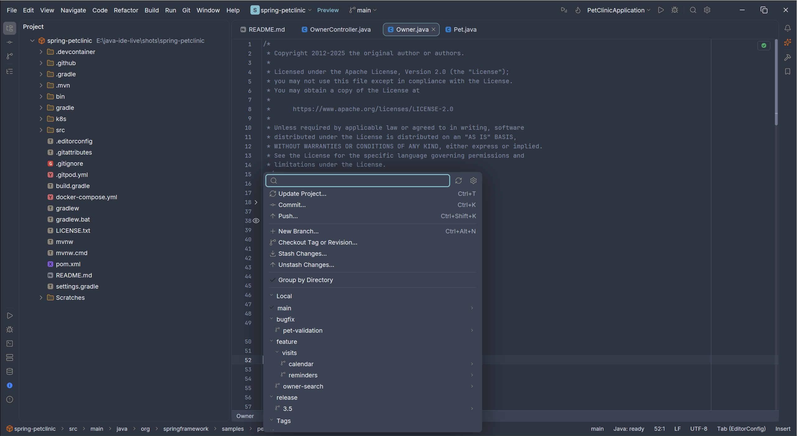
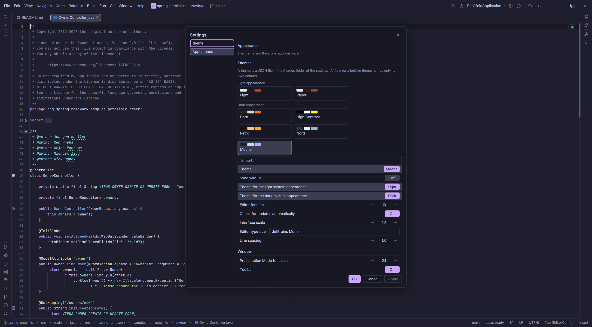
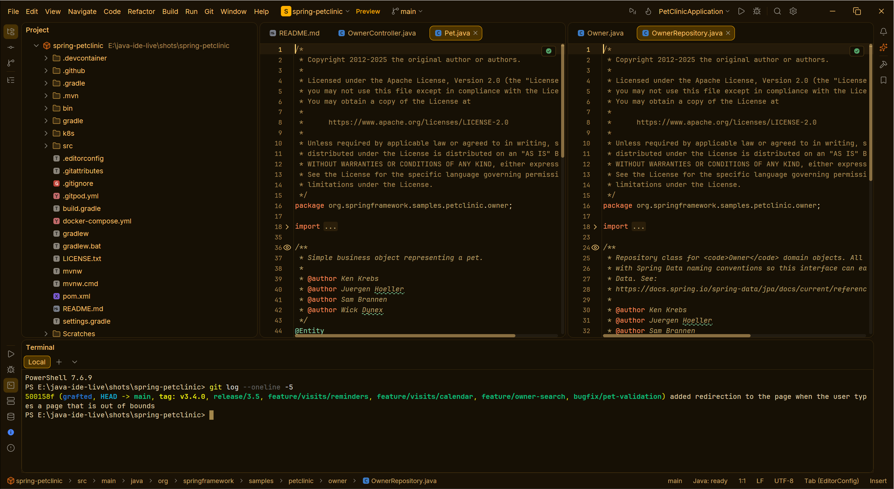

<p align="center">
  
</p>

<h1 align="center">Arro</h1>

<p align="center">
  <b>A fast, native, open-source Java IDE written in Rust, built around AI agents.</b><br>
  IntelliJ-style workflow and shortcuts, a GPU-rendered UI, and a fraction of the memory.
</p>

<p align="center">
  <a href="https://pablosensei.github.io/arro/"><b>Website</b></a> ·
  <a href="https://pablosensei.github.io/arro/changelog/">Changelog</a> ·
  <a href="https://pablosensei.github.io/arro/help/">Help</a> ·
  <a href="https://pablosensei.github.io/arro/roadmap/">Roadmap</a>
</p>

<p align="center">
  <a href="https://github.com/PabloSensei/arro/releases/latest"></a>
  <a href="https://github.com/PabloSensei/arro/releases"></a>
  <a href="LICENSE"></a>
  
  <a href="https://github.com/sponsors/PabloSensei"></a>
</p>

<p align="center">
  
  
  
  
  
  
  
  
</p>

<p align="center">
  <a href="https://github.com/PabloSensei/arro/releases/latest"><b>Download</b></a> ·
  <a href="#features">Features</a> ·
  <a href="#install">Install</a> ·
  <a href="#build-from-source">Build</a> ·
  <a href="#status">Status</a> ·
  <a href="https://github.com/PabloSensei/arro/issues/new">Report a bug</a>
</p>

<p align="center">
  
</p>

> [!NOTE]
> **Arro is young.** It is used for real work every day, but expect rough edges and changes between versions. Bug reports are very welcome.

## Why Arro

- **Native and fast.** Rust from top to bottom and a GPU-rendered UI on GPUI. No Electron, no web view, no JavaScript in the interface.
- **Feels like home for IntelliJ users.** The same shortcuts (Shift Shift, Ctrl+N, Alt+Enter, Ctrl+Alt+L, Shift+F10…), the same menus and the same tool windows, so moving over takes minutes, not weeks.
- **Light.** The IDE itself stays small; the heavy lifting goes to the Eclipse JDT Language Server, which Arro starts, watches and restarts for you.
- **AI-native.** Claude Code, Codex and any MCP client work with Arro, not around it. They read diagnostics, usages and the project structure from the IDE, set breakpoints and step through a test in Arro's own debugger. Their edits come to you as hunks to accept or reject, they build and run tests only with your permission, and **Fix with AI** sends an error to an agent from where you see it.
- **Safe with code you just cloned.** A project you have not trusted yet opens in Safe Mode: you can read, search and use Git, but no build script, Maven or Gradle wrapper, compiler plugin or language server runs until you press Trust Project.
- **Never freezes on a tool.** Builds, Git, the language server and the debugger all run outside the UI thread. A slow Maven import does not stop typing.

## Features

<table>
  <tr>
    <td width="50%" valign="top">
      <h3>Code intelligence</h3>
      Fast completion with documentation and auto-import, Alt+Enter with quick fixes and intentions and a preview of the change, Ctrl+B that jumps at once, semantic highlighting, parameter name hints, Find Usages, call and type hierarchy, class and sequence diagrams, rename, extract, inline, change signature, safe delete, Structural Search and Replace, live and postfix templates, reformat, optimize imports, Create Test, spell checking of comments, strings and names with fixes through Rename, and per-project inspection levels with suppression on Alt+Enter.
    </td>
    <td width="50%" valign="top">
      
    </td>
  </tr>
  <tr>
    <td width="50%" valign="top">
      
    </td>
    <td width="50%" valign="top">
      <h3>Run, test, debug</h3>
      Maven and Gradle projects, run configurations with Before launch steps, compound runs and <code>.env</code> files, gutter run marks for <code>main</code> and tests, a test tree with rerun of failures, auto-test on save and a history of runs, a debugger with breakpoints, stepping, an Evaluate window, hot swap, variable values inline in the editor, Attach to Process with the list of running JVMs, remote attach, marked objects, folded library frames, inline watches and thousands of virtual threads. Analyze Stack Trace turns a pasted trace or thread dump into clickable frames, and Dump Threads reads a running JVM. Run and Debug consoles link to sources and can be searched. A Services window shows every Spring Boot app and main class with its state and port.
    </td>
  </tr>
  <tr>
    <td width="50%" valign="top">
      <h3>Spring, Jakarta EE, Quarkus, Micronaut</h3>
      Completion, hover and checks for <code>application.properties</code> and <code>.yml</code> from the configuration metadata of your class path. A Beans window with injection gutter marks and navigation, an Endpoints window with every HTTP handler, Spring Data JPA query methods and JPQL in <code>@Query</code> completed and checked against your entities, message bundles linked to <code>getMessage</code>, validation messages and Thymeleaf <code>#{…}</code>. A running Spring Boot app gets an Actuator tab with live Health, Beans, Mappings and Environment. CDI and Micronaut beans with <code>@Inject</code> checks, Quarkus and Micronaut configuration keys and endpoints, and Quarkus Dev Mode.
    </td>
    <td width="50%" valign="top">
      <h3>Tools in the window</h3>
      An SQL console for JDBC sources with completion, formatting, templates and <code>.sql</code> files, a schema tree and a table data editor, an HTTP client for <code>.http</code> files that turns pasted cURL into requests and back, a profiler on Java Flight Recorder (CPU, allocations, thread timeline; apps, tests and Maven/Gradle tasks), heap dumps with retained sizes, dominators and paths to GC roots, Flyway and Liquibase migrations with their state in the database, Kubernetes clusters next to Docker in the Services window, a JShell console on the classpath of a module, a dependency analyzer for conflicts and duplicates, newer dependency versions marked in <code>pom.xml</code> and Gradle files, a table editor for <code>.properties</code> bundles of all locales, library sources on demand, and a Markdown preview with images.
    </td>
  </tr>
  <tr>
    <td width="50%" valign="top">
      <h3>Git built in</h3>
      A branches popup with search, favourites, branches folded by their slashes, and checkout, merge, rebase, compare and push from one arrow. A Git window with Local Changes, a Log with the commit graph, filters and the changed files of each commit, and a Git console. A diff window with a toolbar and a file counter, commits of only the hunks you pick, and a Push window with the target branch, tags and force push with lease. Change markers next to the line numbers show the original text and roll a change back. Shelf and stash, conflict resolution, history of a selection or a method, submodules, local history.
    </td>
    <td width="50%" valign="top">
      
    </td>
  </tr>
  <tr>
    <td width="50%" valign="top">
      
    </td>
    <td width="50%" valign="top">
      <h3>Themes</h3>
      Eight built-in themes: Dark, Light, High Contrast, Retro, Nord, Mocha, Paper and Nightfall, the violet dark theme shared with Bowyer. Pick one for the light and one for the dark system appearance and let Arro follow the OS, preview a theme with Quick Switch Scheme (Ctrl+`), write your own as a short JSON file, or import an IntelliJ IDEA <code>.icls</code> color scheme.
    </td>
  </tr>
  <tr>
    <td width="50%" valign="top">
      <h3>Editor and terminal</h3>
      Split editors, a terminal with tabs, search and clickable paths, file type icons, folding, sticky lines, highlighting for Python, C, C++, C#, Go, Rust, Scala, PHP, Ruby, Swift, Lua, PowerShell, Protobuf and more, next to Java. An AI Sessions panel runs Claude Code and Codex inside the IDE, and <code>arro-mcp</code> connects any agent to the open project over MCP.
    </td>
    <td width="50%" valign="top">
      
    </td>
  </tr>
</table>

And the rest you expect from an IDE: a New Project wizard for Maven, Gradle and Spring Boot (Spring Initializr), Search Everywhere, Find in Files, a project tree, file structure, bookmarks, Compare with Clipboard, actions on save (reformat, optimize imports), database drivers that download themselves and passwords kept in the system keychain, Distraction Free, Zen and Presentation modes, a configurable keymap, the code style of a project's <code>.idea</code> folder, settings export and import, Docker services, Lombok support, and automatic updates.

## Install

Download the package or archive for your system from [Releases](https://github.com/PabloSensei/arro/releases/latest). Every file has a `.sha256` file next to it.

Whichever system you use, install a JDK 25 or newer for the language server, for example [Eclipse Temurin 25](https://adoptium.net/temurin/releases/?version=25&package=jdk). Your projects can still build on their own JDK, from 8 to 25. The Java language server and the debugger are already in the archive.

### Windows 11 x86-64

1. Unpack `arro-<version>-windows-x86_64.zip`.
2. Run `arro.exe` and open a folder with a Maven or Gradle project.

`run-arro.cmd` finds the JDK and the bundled tools for you; starting `arro.exe` directly works too.

### Linux x86-64

The build needs glibc 2.35 or newer: Ubuntu 22.04, Debian 12, Fedora 36 or a later release.

On Debian and Ubuntu, install the package:

```shell
sudo apt install ./arro_<version>_amd64.deb
```

On Fedora and openSUSE, install the RPM package:

```shell
sudo dnf install ./arro-<version>-1.x86_64.rpm
```

Both packages put Arro in `/opt/arro`, add `arro` to the path and a shortcut to the application menu. A newer version installs the same way; Arro cannot update a package installation itself, so its update notice opens the release page.

On other distributions, or without root, use the archive:

1. Unpack `arro-<version>-linux-x86_64.tar.gz` anywhere.
2. Run `./install.sh` in that folder. It copies Arro to `~/.local/share/arro` (or to a folder you name), links `~/.local/bin/arro` and adds a shortcut and icons to the application menu, all inside your home folder. `./install.sh --uninstall` removes them again.
3. Or skip the script and run `./arro` from the unpacked folder.

An archive installation updates itself.

The window needs `libfontconfig`, `libwayland`, `libx11`, `libxcb` and `libxkbcommon` at run time. The archive includes `README.txt` with the JDK search paths and the servers it ships.

### macOS (Apple silicon)

1. Open `arro-<version>-macos-aarch64.dmg` and drag `Arro` into Applications. The `.zip` of the same bundle works too and is what the built-in updater uses.
2. The build is signed ad hoc, not notarized: the first start is stopped by Gatekeeper. Control-click `Arro.app`, choose Open and confirm, or run `xattr -dr com.apple.quarantine /Applications/Arro.app`.
3. Open `Arro.app`, or run `open Arro.app --args /work/shop` for a project folder.

An Intel build (`macos-x86_64`) is made when the release runner is an Intel Mac; the Apple silicon archive is the one published today. `README.txt` inside the bundle explains the JDK search and where Arro keeps its files.

### Updates and limitations

Arro checks for updates once a day and can update itself; the check can be turned off in Settings. The updater picks the archive of the running system: the zip on Windows, the tar.gz on Linux, the whole `Arro.app` bundle on macOS. Keep the folder you unpacked Arro into writable, otherwise the update stops with a message.

Known limitations of this preview:

- Linux and macOS are early previews: they build and pass the tests, but fewer people use them than the Windows build.
- The macOS build is not notarized, so the first start needs the step above.
- Linux is built for x86-64 only, and the macOS archive published by the release workflow is for Apple silicon. A build for another architecture has to be made on that architecture.
- There is no Flatpak or Homebrew package yet, and the macOS `.dmg` is not notarized.
- On Linux the terminal uses the system pseudo terminal; the Windows ConPTY is not part of that archive.

## Build from source

```shell
cargo build --release -p ide
cargo run -p xtask -- dist --out <folder>
cargo run -p xtask -- dist --target linux --out <folder> --zip
cargo run -p xtask -- dist --target macos --out <folder> --zip
```

`--target linux` and `--target macos` are built on their own system; the archives they write are the ones the updater looks for.

The Rust toolchain is pinned in [`rust-toolchain.toml`](rust-toolchain.toml). `cargo run -p xtask -- ci` runs formatting, lints, tests, license and architecture checks.

## Status

| Area | State |
|---|---|
| Editor, navigation, refactoring | ✅ Works every day |
| Maven and Gradle, run, tests, debugger | ✅ Works |
| Git | ✅ Works |
| Spring: configuration, beans, endpoints, message bundles, Actuator | 🚧 New, works on Spring PetClinic |
| Database console, HTTP client, profiler, JShell | 🚧 New |
| Jakarta EE, Quarkus, Micronaut, Kubernetes, heap dumps, Flyway and Liquibase | 🚧 New |
| Windows 11 x86-64 | ✅ Supported |
| Linux x86-64 | 🚧 Preview release |
| macOS (Apple silicon; Intel where a runner builds it) | 🚧 Preview release |
| AI agents over MCP (code, run, tests, debugger) and the AI Sessions panel (Claude Code, Codex, OpenCode) | 🚧 New |
| More languages on the same core | 🗓️ Planned |

## Bowyer, the sibling app

[Bowyer](https://github.com/PabloSensei/bowyer) is one native window for every AI coding agent you run: Claude Code, Codex, OpenCode and DeepSeek sessions, on this computer and over SSH, with a mission control grid, full-text search over every session and permission questions answered on the spot. It is built on the same Rust crates as Arro, and a Claude Code session in Bowyer connects to the Arro window that has its folder open.

<p align="center">
  <a href="https://github.com/PabloSensei/bowyer"></a>
</p>

## Support

Arro is free. If it saves you time, you can support its development (mostly AI subscriptions) through [GitHub Sponsors](https://github.com/sponsors/PabloSensei).

Found a problem? [Open an issue](https://github.com/PabloSensei/arro/issues/new).

## Acknowledgements

Arro stands on the work of others: [GPUI](https://github.com/zed-industries/zed) by Zed Industries for the UI, the [Eclipse JDT Language Server](https://github.com/eclipse-jdtls/eclipse.jdt.ls) and [java-debug](https://github.com/microsoft/java-debug) for Java, [tree-sitter](https://tree-sitter.github.io/) for parsing, [Lucide](https://lucide.dev) for icon shapes, and the [Inter](https://rsms.me/inter/) and [JetBrains Mono](https://www.jetbrains.com/lp/mono/) fonts.

## License

Arro is free software, licensed under the [GNU General Public License, version 3 or later](LICENSE) (GPL-3.0-or-later). You may use it for any purpose, including at work, study and change it, and share it, changed or not; whoever shares a changed version shares its source under the same license. This covers every released version of Arro. Plugins run as separate processes and talk to Arro over its plugin protocol, so they may use any license.

Third-party components keep their own licenses; `THIRD-PARTY.txt` and `NOTICE.txt` in every build list them, and the `NOTICE-ARRO.md` files of [`vendor/gpui-pre-windows`](vendor/gpui-pre-windows/NOTICE-ARRO.md), [`vendor/gpui-pre-linux`](vendor/gpui-pre-linux/NOTICE-ARRO.md) and [`vendor/gpui-pre-macos`](vendor/gpui-pre-macos/NOTICE-ARRO.md) list the changes to the vendored GPUI platform crates.
