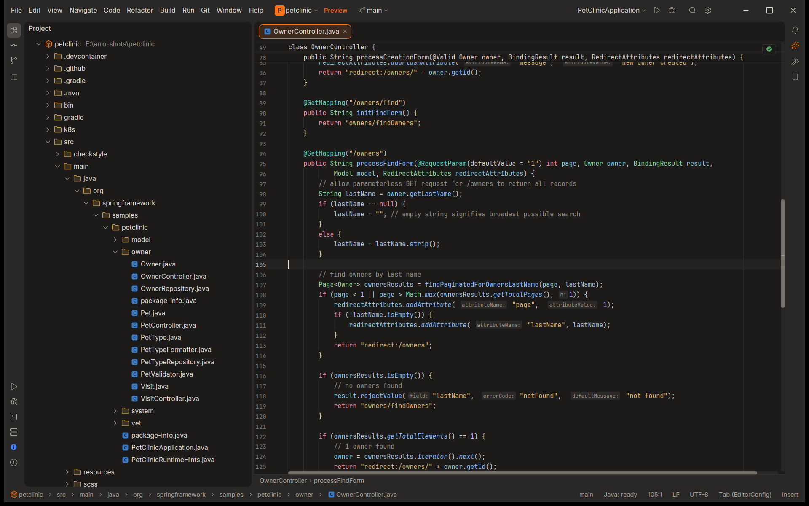
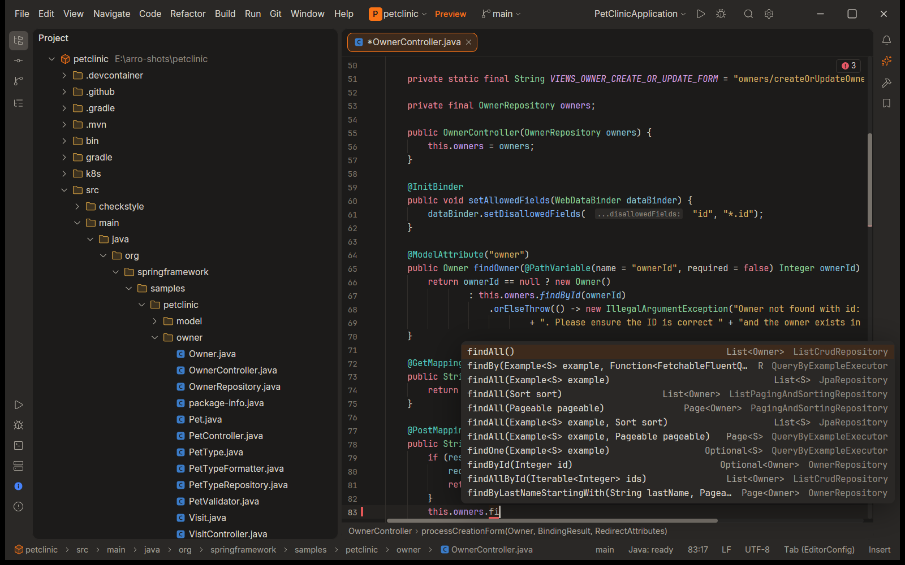
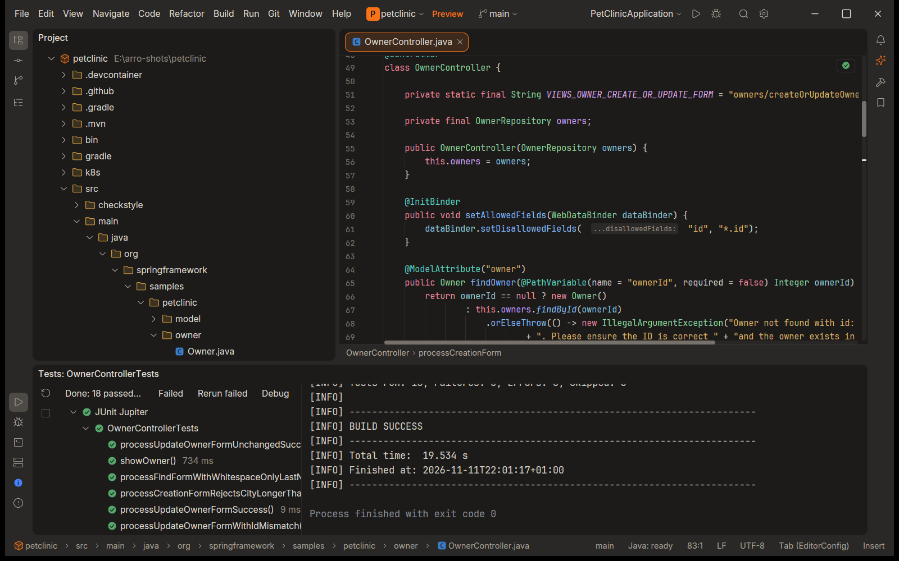
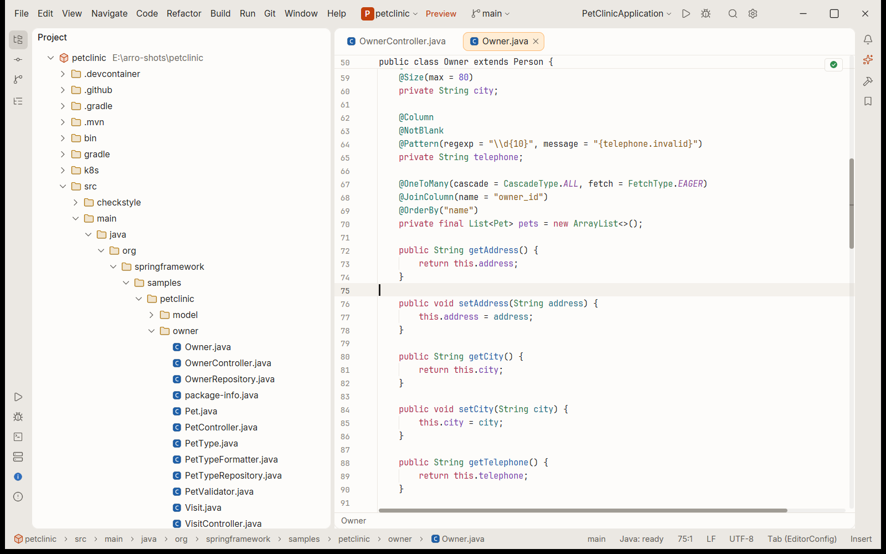

<p align="center">
  
</p>

<h1 align="center">Arro</h1>

<p align="center">
  <b>A native Java IDE written in Rust.</b><br>
  IntelliJ-style workflow and shortcuts, a GPU-rendered UI, and a fraction of the memory.
</p>

<p align="center">
  <a href="https://github.com/PabloSensei/arro/releases/latest"></a>
  <a href="https://github.com/PabloSensei/arro/releases"></a>
  <a href="LICENSE.md"></a>
  
  <a href="https://github.com/sponsors/PabloSensei"></a>
</p>

<p align="center">
  
  
  
  
  
  
  
  
</p>

<p align="center">
  <a href="https://github.com/PabloSensei/arro/releases/latest"><b>Download</b></a> ·
  <a href="#features">Features</a> ·
  <a href="#install">Install</a> ·
  <a href="#build-from-source">Build</a> ·
  <a href="#status">Status</a> ·
  <a href="https://github.com/PabloSensei/arro/issues/new">Report a bug</a>
</p>

<p align="center">
  
</p>

> [!WARNING]
> **Early preview.** Arro is young. Expect rough edges, missing features and breaking changes between versions. Bug reports are very welcome.

> [!NOTE]
> **Written with AI.** Most of the code is generated by language models, then reviewed, tested and merged by a human. We say so openly.

## Why Arro

- **Native and fast.** Rust from top to bottom and a GPU-rendered UI on GPUI. No Electron, no web view, no JavaScript in the interface.
- **Feels like home for IntelliJ users.** The same shortcuts (Shift Shift, Ctrl+N, Alt+Enter, Ctrl+Alt+L, Shift+F10…), the same menus and the same tool windows, so moving over takes minutes, not weeks.
- **Light.** The IDE itself stays small; the heavy lifting goes to the Eclipse JDT Language Server, which Arro starts, watches and restarts for you.
- **Never freezes on a tool.** Builds, Git, the language server and the debugger all run outside the UI thread. A slow Maven import does not stop typing.

## Features

<table>
  <tr>
    <td width="50%" valign="top">
      <h3>Code intelligence</h3>
      Completion with auto-import, quick fixes on Alt+Enter, semantic highlighting, parameter name hints, Find Usages, call and type hierarchy, rename, extract, inline, change signature, safe delete, live and postfix templates, reformat, optimize imports.
    </td>
    <td width="50%" valign="top">
      
    </td>
  </tr>
  <tr>
    <td width="50%" valign="top">
      
    </td>
    <td width="50%" valign="top">
      <h3>Run, test, debug</h3>
      Maven and Gradle projects, run configurations, gutter run marks for <code>main</code> and tests, a test tree with rerun of failures, a debugger with breakpoints, stepping, evaluation, hot swap and thousands of virtual threads.
    </td>
  </tr>
  <tr>
    <td width="50%" valign="top">
      <h3>Git built in</h3>
      Commit, diff, log, branches with merge, rebase and compare, shelf and stash, conflict resolution, local history.
    </td>
    <td width="50%" valign="top">
      
    </td>
  </tr>
</table>

And the rest you expect from an IDE: Search Everywhere, Find in Files, a project tree, a terminal, file structure, bookmarks, split editors, dark and light themes, a configurable keymap, Docker services, Lombok support, and automatic updates.

## Install

Download the archive for your system from [Releases](https://github.com/PabloSensei/arro/releases/latest) and unpack it anywhere. There is no installer. Every archive has a `.sha256` file next to it.

Whichever system you use, install a JDK 25 or newer for the language server, for example [Eclipse Temurin 25](https://adoptium.net/temurin/releases/?version=25&package=jdk). Your projects can still build on their own JDK, from 8 to 25. The Java language server and the debugger are already in the archive.

### Windows 11 x86-64

1. Unpack `arro-<version>-windows-x86_64.zip`.
2. Run `arro.exe` and open a folder with a Maven or Gradle project.

`run-arro.cmd` finds the JDK and the bundled tools for you; starting `arro.exe` directly works too.

### Linux x86-64

The build needs glibc 2.35 or newer: Ubuntu 22.04, Debian 12, Fedora 36 or a later release.

1. Unpack `arro-<version>-linux-x86_64.tar.gz`, for example into `~/opt`.
2. Run `./arro` from that folder.
3. If you want a shortcut in the application menu, run `./install.sh` and answer the question. It writes only to `~/.local/share` of your user; nothing is installed automatically.

The window needs `libfontconfig`, `libwayland`, `libx11`, `libxcb` and `libxkbcommon` at run time. The archive includes `README.txt` with the JDK search paths and the servers it ships.

### macOS (Apple silicon)

1. Unpack `arro-<version>-macos-aarch64.zip` and drag `Arro.app` into Applications, or run it from where it is unpacked.
2. The build is signed ad hoc, not notarized: the first start is stopped by Gatekeeper. Control-click `Arro.app`, choose Open and confirm, or run `xattr -dr com.apple.quarantine /Applications/Arro.app`.
3. Open `Arro.app`, or run `open Arro.app --args /work/shop` for a project folder.

An Intel build (`macos-x86_64`) is made when the release runner is an Intel Mac; the Apple silicon archive is the one published today. `README.txt` inside the bundle explains the JDK search and where Arro keeps its files.

### Updates and limitations

Arro checks for updates once a day and can update itself; the check can be turned off in Settings. The updater picks the archive of the running system: the zip on Windows, the tar.gz on Linux, the whole `Arro.app` bundle on macOS. Keep the folder you unpacked Arro into writable, otherwise the update stops with a message.

Known limitations of this preview:

- Linux and macOS are early previews: they build and pass the tests, but fewer people use them than the Windows build.
- The macOS build is not notarized, so the first start needs the step above.
- Linux is built for x86-64 only, and the macOS archive published by the release workflow is for Apple silicon. A build for another architecture has to be made on that architecture.
- There is no `.deb`, `.rpm`, Flatpak or Homebrew package yet, and the macOS bundle is not a signed `.dmg`.
- On Linux the terminal uses the system pseudo terminal; the Windows ConPTY is not part of that archive.

## Build from source

```shell
cargo build --release -p ide
cargo run -p xtask -- dist --out <folder>
cargo run -p xtask -- dist --target linux --out <folder> --zip
cargo run -p xtask -- dist --target macos --out <folder> --zip
```

`--target linux` and `--target macos` are built on their own system; the archives they write are the ones the updater looks for.

The Rust toolchain is pinned in [`rust-toolchain.toml`](rust-toolchain.toml). `cargo run -p xtask -- ci` runs formatting, lints, tests, license and architecture checks.

## Status

| Area | State |
|---|---|
| Editor, navigation, refactoring | ✅ Works every day |
| Maven and Gradle, run, tests, debugger | ✅ Works |
| Git | ✅ Works |
| Windows 11 x86-64 | ✅ Supported |
| Linux x86-64 | 🚧 Preview release |
| macOS (Apple silicon; Intel where a runner builds it) | 🚧 Preview release |
| AI agent panel (Claude Code, Codex, OpenCode) | 🚧 In progress |
| More languages on the same core | 🗓️ Planned |

## Support

Arro is free. If it saves you time, you can support its development (mostly AI subscriptions) through [GitHub Sponsors](https://github.com/sponsors/PabloSensei).

Found a problem? [Open an issue](https://github.com/PabloSensei/arro/issues/new).

## Acknowledgements

Arro stands on the work of others: [GPUI](https://github.com/zed-industries/zed) by Zed Industries for the UI, the [Eclipse JDT Language Server](https://github.com/eclipse-jdtls/eclipse.jdt.ls) and [java-debug](https://github.com/microsoft/java-debug) for Java, [tree-sitter](https://tree-sitter.github.io/) for parsing, [Lucide](https://lucide.dev) for icon shapes, and the [Inter](https://rsms.me/inter/) and [JetBrains Mono](https://www.jetbrains.com/lp/mono/) fonts.

## License

Arro is licensed under the [Functional Source License, Version 1.1, ALv2 Future License](LICENSE.md) (FSL-1.1-ALv2). You may use, modify and share it for any purpose except offering a competing commercial product. Two years after each version is released, that version also becomes available under the Apache License 2.0.

Third-party components keep their own licenses; `THIRD-PARTY.txt` and `NOTICE.txt` in every build list them, and [`vendor/gpui-pre-windows/NOTICE-ARRO.md`](vendor/gpui-pre-windows/NOTICE-ARRO.md) lists the changes to the vendored GPUI platform crate.
